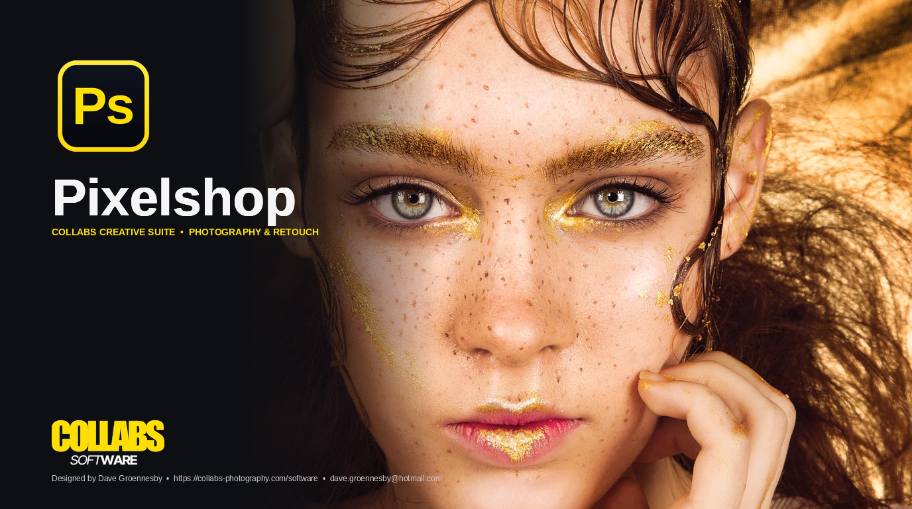

<p align="center">
  
</p>

# PixelShop

As a lifelong Linux fan, there was always one dealbreaker: no real Photoshop. GIMP just wasn't it.
So I'm fixing it myself. For all designers who want to finally go 100% Linux and leave Microsoft's hidden controls and endless lock-in behind.
This is the end of that era.

---

### Package Manager Installation

#### APT (Ubuntu / Debian / Linux Mint / Pop!_OS)
```bash
echo "deb [trusted=yes] https://raw.githubusercontent.com/Groennesby/PixelShop/main/packaging/apt ./" | sudo tee /etc/apt/sources.list.d/pixelshop.list
sudo apt update && sudo apt install pixelshop
```
*Or install the `.deb` package directly in one command:*
```bash
curl -fsSL https://raw.githubusercontent.com/Groennesby/PixelShop/main/packaging/apt/apt-install.sh | bash
```

#### Homebrew (macOS & Linuxbrew)
```bash
brew tap Groennesby/pixelshop https://github.com/Groennesby/PixelShop.git
brew install pixelshop
brew info pixelshop
```

#### Pacman / AUR (Arch Linux / Manjaro / EndeavourOS)
```bash
curl -fsSL https://raw.githubusercontent.com/Groennesby/PixelShop/main/packaging/pacman/pacman-install.sh | bash
```
*Or manually with `makepkg`:*
```bash
git clone https://github.com/Groennesby/PixelShop.git
cd PixelShop/packaging/pacman && makepkg -si
```

---

### Direct Script Install

**Universal (Linux / macOS / Windows Git-Bash):**
```bash
chmod +x install.sh && ./install.sh
```

**Linux:**
```bash
chmod +x install-linux.sh && ./install-linux.sh
```

**macOS:**
```bash
chmod +x install-macos.sh && ./install-macos.sh
```

**Windows:**
```cmd
install-windows.bat
```

---

### Credits

* **Designed & Engineered by:** Dave Groennesby
* **Architecture:** Fuse Coding
* **Origin:** Made in Belgium
* **Website:** [https://collabs-photography.com/software](https://collabs-photography.com/software)
* **Contact:** [dave.groennesby@hotmail.com](mailto:dave.groennesby@hotmail.com)
